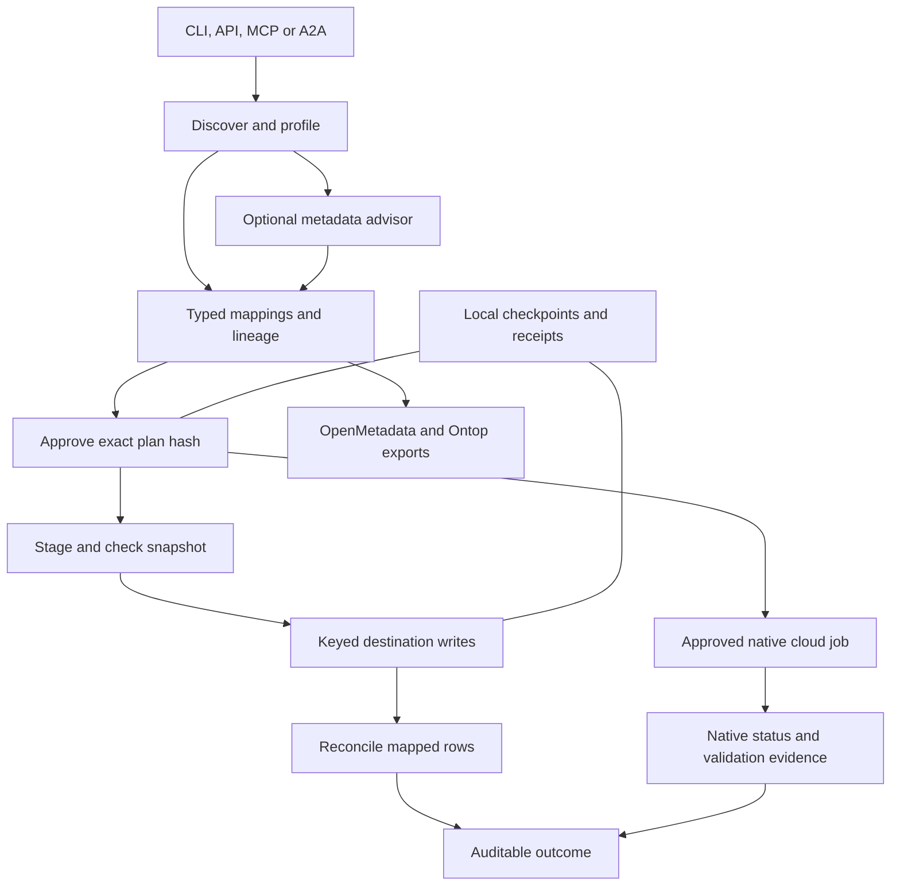

# DataMigration

<p align="center">
  <video src="docs/video/datamigration-ui-walkthrough.mp4" width="720" controls muted playsinline></video>
</p>

A **LangGraph-based migration workbench** for discovering source and target tables,
reviewing mappings, approving a precise plan, moving data through deterministic
workers, and reconciling the result. It includes AWS, Azure and Databricks job
adapters, a **Next.js operator console with Ask Q**, an authenticated API, MCP, A2A,
data-quality rules, and governance exports.

**Release scope:** the runnable v0.1 migration engine plus a Next.js console,
with real local integration tests and remote-adapter contract tests. It is not a certification of
every database pair or a fully managed migration service. The implemented control
plane runs on **one host with a durable local state directory**. Network database
connectors and cloud deployments need qualification in your environment.

## Start here

| Goal | Guide |
| --- | --- |
| Open the operator console | [Next.js quickstart](#nextjs-console) and [frontend setup](docs/frontend.md) |
| Get contextual setup/status guidance | [Ask Q companion](docs/ask-q.md) |
| Review or render the 60-second walkthrough | [Video sources, captions and transcript](docs/video/README.md) |
| Run a migration and understand approval/validation | [Quickstart](#quickstart) and [migration workflow](#migrate-your-data) |
| Choose source/target databases, files and supported types | [Connector matrix and contracts](docs/connectors.md) |
| Model OLTP, OLAP, facts and dimensions | [Data models](docs/data-models.md) |
| Apply data-quality rules and audit corrections | [Data quality](docs/data-quality.md) |
| Configure users, database/table scopes, MCP or A2A | [Protocols and RBAC](docs/protocols-and-rbac.md) |
| Use Ontop, OpenMetadata or column lineage | [Governance](docs/governance.md) |
| Deploy in AWS, Azure or Databricks | [AWS](docs/architecture/aws.md), [Azure](docs/architecture/azure.md), [Databricks](docs/architecture/databricks.md) |
| Install CI/CD and SonarQube gates | [CI/CD](docs/cicd.md) and [host deployment](infra/deploy/README.md) |
| Review what was actually tested | [Verification record](docs/verification.md) |
| Choose a platform based on cost and operating needs | [Platform selection and cost](docs/platform-selection.md) |
| Prioritize the remaining production work | [Product gaps and roadmap](docs/roadmap.md) |

## What the agent does

LangGraph manages state, review, execution and recovery. An optional model can
suggest semantic hypotheses and validation questions from **schema metadata and
aggregate profiles**. It cannot approve a migration, change mappings, run generated
SQL, or receive raw source rows through the advisor interface. With the advisor
disabled, the complete migration workflow runs without a model API.



There are two execution contracts:

- **Local snapshots:** all selected source tables are staged and checked before
  the first destination write. The engine then performs keyed upserts, records
  batch receipts and compares all mapped values by key. It finishes as
  `COMPLETED` only after reconciliation succeeds.
- **Native cloud jobs:** a separate LangGraph workflow compiles a bundle, pauses
  for its exact hash, submits an existing approved job and tracks its receipt.
  Provider success ends at `EXECUTION_SUCCEEDED_REQUIRES_RECONCILIATION`; application
  cutover and independent validation remain explicit subsequent operations.

## Quickstart

Use Python 3.11–3.13; CI uses Python 3.12. From a fresh checkout:

```bash
git clone https://github.com/mahi80/DataMigration.git
cd DataMigration
python3 -m venv .venv
source .venv/bin/activate
python -m pip install -e .

datamigrate demo --directory .demo/oltp --run-id demo-oltp
datamigrate status demo-oltp
```

This creates a new synthetic SQLite source with customers, products, orders and
order items, migrates it to a separate SQLite destination, and reconciles it.
The demo automatically approves **only the synthetic fixture it creates**. Normal
`run` commands always stop for approval. Use a new directory/run ID to repeat the
demo; it deliberately refuses to overwrite existing demo databases.

For an explicitly modeled star schema and a real local Delta Lake target:

```bash
python -m pip install -e '.[delta]'
datamigrate demo --directory .demo/star-delta --run-id demo-star --star --delta
```

The star fixture materializes `dim_customer`, `dim_product` and `fact_sales` using
reviewed example SQL, then migrates those three tables. It demonstrates dimension
ordering and fact preservation; it does not infer arbitrary business joins or
generate SCD Type 2 history.

## Next.js console

The responsive console connects to the real API for run history, registered
connections, table discovery, mapping review, exact-hash approvals and validation
results. It provides role-aware controls, loading/error/empty states, and
source-to-target lineage inspection. Overview metrics describe the loaded runs;
they are not synthetic production statistics.

**Ask Q** is an animated, draggable SVG companion for setup, supported-feature
questions and authorized run evidence. Guided mode works locally; an optional
model only selects existing help-card IDs. Suggestions open the existing
wizard, exact-plan review or confirmed recovery flow. Opt-in status checks run
every eight seconds while the workspace is open, including with Q minimized,
and pause when the browser tab is hidden. See [Ask Q](docs/ask-q.md) for its
controls, context/privacy boundaries and server-only configuration.

For a local demonstration, use Node.js 22.12 or later in the 22.x series and the
Python environment above:

```bash
python -m pip install -e '.[api]'
npm --prefix frontend ci
python examples/console/serve_demo.py --directory .demo/console
```

Open **http://localhost:3000** and sign in with the demo administrator token
printed by the launcher. Other role tokens are saved privately in
`.demo/console/demo-access.json` so you can exercise planner/approver separation.
The launcher creates actual synthetic runs, including completed migrations,
plans awaiting review and an intentionally failed quality rule. It starts the
API and Next.js together; no cloud or external database is used. Use a fresh
`--directory` when repeating the demo.

For your own workspace, configure the API's `MIGRATION_CONNECTIONS` registry and
role-token bindings, then set the frontend's fixed API URL, public origin and
session-encryption secret. The browser uses an encrypted HTTP-only session
cookie; source credentials remain with the API. Follow
[frontend setup](docs/frontend.md) for the complete configuration and test commands.

The console currently manages snapshot migrations. Native cloud execution stays
in the existing cloud CLI/Python interfaces. Enterprise SSO, durable queued
execution, distributed state and other production priorities are tracked in
[the roadmap](docs/roadmap.md).

The [60-second product walkthrough](docs/video/README.md) has a reusable renderer,
the actual Ask Q SVG, captions, storyboard and text transcript. The MP4 is
delivered separately; the repository keeps the reproducible source assets.

## Source and target coverage

Every direct connector below reads snapshots and writes keyed upserts. A checkmark
means an adapter is implemented, **not** that arbitrary cross-engine conversion is
semantically equivalent. Follow its type/key restrictions and the detailed
[connector guide](docs/connectors.md).

| Database or file | Source | Target | Material boundary | Verification |
| --- | :---: | :---: | --- | --- |
| SQLite | Yes | Yes | Local tables; arbitrary exact Decimal storage rejected | Real local integration |
| PostgreSQL | Yes | Yes | SQLAlchemy/psycopg; mapped DDL or existing unique keys | Shared SQL tests; no live PostgreSQL |
| MySQL | Yes | Yes | Existing target schema and enforced keys | Implemented; service testing required |
| SQL Server / Azure SQL | Yes | Yes | SQLAlchemy/ODBC; existing target tables | Implemented; service testing required |
| MongoDB | Yes | Yes | Ordered canonical BSON Extended JSON strings; no automatic flattening | BSON and fake-service tests |
| Redis | Yes | Yes | Redis 7+ hashes, restricted prefix, binary values and absolute key expiry | Fake-service contract tests |
| Cassandra | Yes | Yes | Existing scalar tables; full partition/clustering keys; no TTL/counters/collections | Limited adapter tests |
| Amazon Redshift | Yes | Yes | Existing tables; bounded staging plus `MERGE` | SQL contract tests |
| Databricks SQL | Yes | Yes | Existing scalar Delta tables through a SQL warehouse; explicit keys | Identifier/binding contract tests |
| Delta Lake | Yes | Yes | delta-rs, pinned table versions, keyed `MERGE`, no automatic schema evolution | Real local integration |
| CSV | Yes | Yes | Explicit types and null representation; local files | Real local integration |
| JSONL | Yes | Yes | Explicit schema or generated typed sidecar; local files | Real local integration |
| Parquet | Yes | Yes | One local scalar Arrow file per table | Real local integration |

The local engine does not implement CDC. The guarded **AWS DMS** integration
orchestrates an existing reviewed full-load-and-CDC task. The **ADF** compiler
currently covers SQL Server/Azure SQL → Azure SQL snapshots. The Databricks Jobs
reference worker covers pinned Delta → Delta identity/rename mappings. Cloud
service connector catalogs are broader than these implemented templates.

Oracle, Snowflake, Db2, Elasticsearch, SAP, arbitrary REST/SaaS APIs, Kafka streams,
and whole Redis/Cassandra server migrations are not direct migration connectors
in this release. Some are eligible for semantic export or future/native workers;
that is a separate capability.

## Migrate your data

### 1. Configure connections and inspect the inventory

Install only the drivers you need, for example:

```bash
python -m pip install -e '.[postgres,delta,files,queries]'
```

Set `SOURCE_DATABASE_URL` and `TARGET_DELTA_ROOT` through your shell or secret
manager. `.env.example` lists environment-variable names; the CLI does not
automatically load dotenv files. Credentials stay in environment values, never in
committed YAML. Local filesystem roots should be absolute.

Start from [PostgreSQL → Delta](examples/postgresql-to-delta.yaml),
[MongoDB → PostgreSQL](examples/mongodb-to-postgresql.yaml), or
[Redis hashes → PostgreSQL](examples/redis-to-postgresql.yaml).

```bash
datamigrate connectors
datamigrate discover examples/postgresql-to-delta.yaml --side source
datamigrate discover examples/postgresql-to-delta.yaml --side target
datamigrate inspect-sql examples/postgresql-to-delta.yaml --side source \
  --output artifacts/source-inventory.json
```

Discovery accepts either a migration spec or one `Connection` object. Repeat
`--table NAME` to select tables; discovery is bounded by `--max-tables` (default
100). Use `--names-only` to list assets whose native column types need a reviewed
projection before migration. It reports the configured database/namespace, not every database accessible
to an account. SQL inventory includes schemas, table/view names, and supported
stored-procedure metadata. `--include-definitions` explicitly opts into returning
authorized view/procedure bodies. Neither command executes a stored procedure.

SQLAlchemy supplies dialect-aware reflection and bound SQL for relational
connections. Flat files use explicit schemas and Arrow/typed codecs, because a
file has no database transaction/ORM engine. Reviewed nested SELECT/CTE sources
are configured through `options.queries`, with bound parameters, declared output
types/keys and `read_only_queries: true`; see [query sources](docs/connectors.md).
A database-enforced read-only identity remains required. SQL parsing alone cannot
prove that every database function is free of side effects.

Runnable synthetic examples exercise the complete review/load/validation path:

```bash
python examples/flatfiles/run_example.py --directory .demo/files
python examples/queries/run_example.py --directory .demo/queries
python examples/orm/run_example.py --directory .demo/orm
```

The ORM example creates a source with SQLAlchemy declarative models and migrates
its physical table. Application callbacks, ORM relationships and stored-procedure
behavior require their own reviewed application migration.

### 2. Define the exact mapping and quality policy

Example table entry:

```yaml
source: public.customers
target: customers
keys: [customer_id]
columns:
  - {source: id, target: customer_id, data_type: integer, nullable: false}
  - {source: name, target: customer_name, data_type: string, transform: trim}
  - {source: email, target: email, data_type: string, nullable: false}
quality_rules:
  - {name: email-present, column: email, check: non_blank, correction: lower}
  - {name: email-unique, column: email, check: unique}
```

Set `policy.source_quiesced: true` **only after** arranging a stable source through
an actual maintenance window, immutable export or suitable database snapshot.
The flag records that prerequisite; it does not freeze the database. Default
limits are 100,000 rows per table and 500 rows per batch. Larger bulk migrations
should move data through qualified native workers.

Use `depends_on` for dimensions/parent tables that must precede facts/children.
Define Decimal precision/scale and timestamp timezone semantics explicitly where
needed. The local engine rejects source and target resolving to the same resource;
in-place transforms need a separately reviewed native job.

### 3. Review, approve and reconcile

```bash
datamigrate run examples/postgresql-to-delta.yaml --run-id customers-001
datamigrate status customers-001
```

Inspect the reported `artifact_directory`, especially `plan.json`, `catalog.json`
and `advice.json`. Review source/target bindings, keys, mappings, transformations,
quality corrections, row limits and target scope. Copy the exact `plan_hash` into:

```bash
datamigrate approve customers-001 \
  --plan-hash '<reviewed-plan-hash>' --reviewer 'data-owner@example.com'
datamigrate status customers-001
```

Use `reject` with the same hash and reviewer to end a pending run. After an
interrupted or failed execution, investigate the cause and use
`datamigrate retry customers-001`; retained staging and batch receipts support
replay without inventing a new approval. A changed endpoint/schema/plan requires
review. Keep the workspace and destination under the same operator's control.

`policy.target_scope: entire_table` checks for unexpected destination keys.
`mapped_keys` validates only the staged source keys and reports extra destination
rows outside that scope. Both compare **all mapped columns**. Keys must be stable
and unique; value hashing preserves Decimal, timestamps, binary and nested JSON
representations without leaking raw values into mismatch summaries.

Quality checks include non-null, non-blank, uniqueness, regular expressions,
numeric ranges and allowed values. Corrections are restricted to approved text
trim/lower/upper rules. All rules validate the final corrected row. Failed checks
produce an audit artifact before destination writes; they do not invent missing
business values or silently discard bad rows. See [quality details](docs/data-quality.md).

## API, RBAC, MCP and A2A

```bash
python -m pip install -e '.[api,mcp]'
# Set a random MIGRATION_API_TOKEN with at least 24 characters for local admin use.
datamigrate serve --workspace .migration
```

For shared use, configure server-owned `MIGRATION_API_TOKEN_ROLES` bindings and
separate viewer, planner, approver, operator and admin identities. Bind identities
to allowed connection environment references, table names and connection options.
The approval ledger records the authenticated subject, not a caller-supplied role
or reviewer name. Use native database permissions for source reads and restricted
destination writes, and an authenticated TLS proxy for remote access.

| Interface | Implemented operations |
| --- | --- |
| HTTP API | Connector inventory, schema discovery, plan creation/status/read, approval/rejection, retry |
| MCP stdio | `list_connectors`, `discover_tables`, `plan_migration`, `get_run_status`, `get_migration_plan` |
| A2A 1.0 JSON-RPC | `SendMessage`, `GetTask`; discovery/planning/status lifecycle; no streaming/push notifications |

Start MCP with `datamigrate mcp --workspace .migration` or `datamigrate-mcp`.
The process identity is bound at startup; tools cannot elevate their role. MCP
does not expose an approval or arbitrary SQL/shell tool.

The API advertises its Agent Card at `/.well-known/agent-card.json` and serves
JSON-RPC at `/a2a`. Configure `MIGRATION_PUBLIC_URL` or `serve --public-url` with
the public HTTPS origin. A2A migration tasks pause at `INPUT_REQUIRED`; approval
uses the separate authenticated API. See complete clients, role configuration,
scope examples and protocol boundaries in [protocols and RBAC](docs/protocols-and-rbac.md).

The CLI is a trusted local operator interface. Filesystem/host access can bypass
HTTP role separation, so do not grant shared shell access to the service account.

## AWS, Azure and Databricks

Compile reviewable bundles without creating cloud resources:

```bash
datamigrate cloud compile aws examples/cloud/aws-glue.json --output artifacts/aws-bundle.json
datamigrate cloud compile azure examples/cloud/azure-copy.json --output artifacts/azure-bundle.json
datamigrate cloud compile databricks examples/cloud/databricks-delta.json --output artifacts/databricks-bundle.json
```

After configuring and reviewing the actual resource IDs and provisioning those
resources through your infrastructure process:

```bash
datamigrate cloud run aws examples/cloud/aws-glue.json --run-id aws-001
datamigrate cloud approve aws-001 \
  --bundle-hash '<reviewed-bundle-hash>' --reviewer 'data-owner@example.com'
datamigrate cloud poll aws-001
```

| Platform | Native data plane | Agent/model and governance integration |
| --- | --- | --- |
| AWS | Step Functions Standard, approved Glue job, guarded existing DMS task | Optional Bedrock advisor; Glue Crawler/Data Catalog as architectural discovery inputs; OpenMetadata |
| Azure | Existing ADF factory, reviewed pipeline/linked services/datasets | Optional Azure-hosted model advisor; Key Vault/managed identity deployment design; OpenMetadata |
| Databricks | SQL warehouse adapter and Jobs adapter; reference Delta PySpark worker | Delta Lake storage, Unity Catalog access/governance, optional Mosaic AI Model Serving advisor |

The repository does not automatically deploy Glue Crawlers or a generic Glue
worker. The Databricks reference job uses pinned Delta versions and checks its
supported contract. ADF, DMS and the reference Databricks template reject unsupported
quality corrections rather than dropping them. An approved Glue worker must
enforce every rule in its manifest or reject the plan before writes.

Mosaic AI is the optional model-serving part of the architecture; Delta Lake is
the table/storage layer; Unity Catalog governs registered assets. A direct
object-storage credential does not automatically inherit Unity Catalog policy.

## Ontology, catalog and lineage

The plan records table/column lineage, transformations and quality rules. The
OpenMetadata adapter publishes reviewed table metadata and explicit lineage to
an existing catalog hierarchy. The Ontop exporter writes R2RML, OWL and an
unpopulated JDBC properties template for SQL-facing targets:

```bash
datamigrate ontology examples/governance/target_mapping.json \
  --output artifacts/ontop --base-iri https://data.example.com/commerce/
```

Publish reviewed catalog metadata using `catalog-hash` and `publish-catalog`;
the latter requires the exact catalog hash and a configured OpenMetadata token.
Group catalogs by actual parent schema and provide unqualified table names within
that schema. Follow [the governance guide](docs/governance.md) for lineage UUID
resolution, SQL-facing backend eligibility and private JDBC configuration.

Ontop supplies virtual semantic querying, OpenMetadata supplies catalog/lineage,
and database/cloud identities enforce access. Neither replaces reconciliation.

## Deployment and CI/CD

The cloud rollout scripts deploy **one API container on an existing AWS EC2
instance or Azure VM with a local encrypted disk**. It preserves SQLite checkpoints,
staging and receipt ledgers under `/state`. Do not place SQLite WAL state on
EFS/Azure Files, use multiple replicas, or let multiple control planes write the
same destination. A distributed PostgreSQL-backed state/locking architecture is
documented as future work; it is not implemented by changing an environment variable.

The Next.js console runs as a separate companion container. The root
`compose.console.yml` provides a local single-host composition with private API
networking and loopback ports. Existing AWS/Azure rollout scripts still deploy
the API image only; frontend registry publication, TLS ingress and companion
rollout need the reviewed extension described in [frontend deployment](docs/frontend.md#containers-and-cloud-placement).

The workflows provide:

1. Python/frontend lint, TypeScript checks, unit coverage, browser workflows,
   package builds and both application image checks.
2. SonarQube analysis with `sonar.qualitygate.wait=true`.
3. OIDC-based ECR/ACR publication and immutable image-digest deployment.
4. Separate build/deploy identities and protected GitHub deployment environments.
5. Maintenance drain, health verification and controlled image rollback before
   new work is admitted. Image rollback does not roll back migrated business data.

Configure `SONAR_HOST_URL`, `SONAR_TOKEN`, cloud identity/resource variables and
required environment reviewers using [the CI/CD guide](docs/cicd.md). Deployments
fail if the Sonar gate is unavailable or unsuccessful. Creating an environment
name in YAML does not configure its reviewer or branch-protection rules.

No cloud infrastructure, paid service or SonarQube instance is provisioned by
installing the package or running a demo. Docker/cloud execution is validated in
your configured CI environment, not claimed as a local test result.

The default image includes the API, PostgreSQL, MongoDB, Redis, Delta/files,
query/MCP, AWS, Azure and Databricks extras. Add other drivers through the
`INSTALL_EXTRAS` build argument when needed. SQL Server also requires a compatible
system ODBC driver; selecting the Python extra alone does not install it.

## Development and verification

```bash
python -m pip install 'uv==0.13.6'
uv sync --frozen --extra dev --extra aws --extra azure --extra databricks
uv run --no-sync ruff check .
uv run --no-sync pytest
uv run --no-sync pytest --cov=datamigration --cov-config=infra/coverage.ini --cov-report=term-missing
```

`uv.lock` pins the resolved dependencies used by CI and the container build.
The quickstart's pip installation remains available when you only need a small
local demo and accept resolving compatible dependency versions.

Tests cover approval/restart behavior, exact-hash and endpoint binding, schema
drift, failure before first write, lost acknowledgements after committed writes,
duplicate keys, full-value reconciliation, Decimal/timezone fidelity, actual
local Delta/flat-file transfers, DQ corrections, role/scope denial, the MCP stdio
handshake, A2A official SDK schemas, cloud submission contracts and RDF/HTTP
governance contracts. Passing those tests does not establish throughput or remote
service compatibility for a particular customer's schema.

## Operating boundaries

- **Snapshot consistency:** arrange a stable source and exclusive destination
  ownership; per-table Delta versions are not a cross-table transaction.
- **Schema and application logic:** mapped columns/keys are handled; indexes,
  foreign keys, grants, triggers, stored procedures, extensions, defaults and
  application behavior need separate reviewed migration work.
- **Failure recovery:** upserts and receipts support replay. There is no global
  cross-database transaction, automatic delete propagation or destructive rollback.
- **Sensitive state:** staging contains actual rows. Keep `/state` private,
  encrypted, backed up consistently and subject to a retention policy. Preserve
  receipts until their migrations can no longer be retried.
- **Cost:** model calls are optional, but compute, storage, network, native jobs,
  operations and support still cost money. See [platform selection](docs/platform-selection.md)
  for workload choices and cost decision criteria.

## Design references

The design uses public documentation and independently written code.
LangGraph's [persistence](https://docs.langchain.com/oss/python/langgraph/persistence)
and [interrupt](https://docs.langchain.com/oss/python/langgraph/interrupts)
documentation informs the checkpoint/approval design. Provider-specific sources
are linked from each architecture guide.
