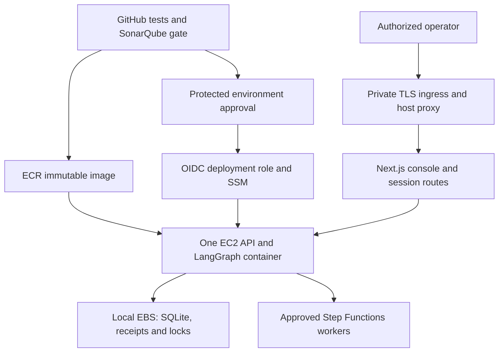
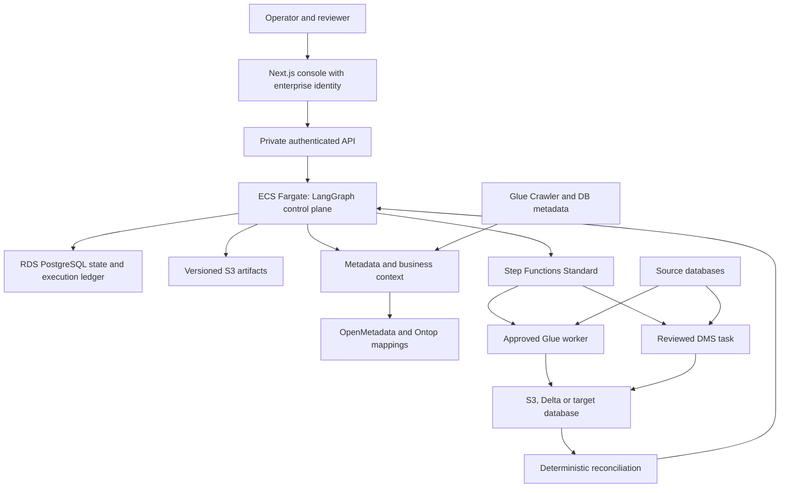

# AWS architecture and execution guide

## Implementation boundary

This repository includes a LangGraph approval/status workflow, an AWS execution
bundle compiler, a real boto3 Step Functions adapter, a Glue `.sync` state-machine
template, and a guarded DMS full-load-and-CDC template. These components have
offline contract tests. No AWS account or production database was used to validate
this release. A Glue worker, databases, network routes and DMS endpoints must be
provisioned and qualified for the actual migration.

## Shipped pilot deployment

The API deployment workflow targets one existing EC2 instance with encrypted local
EBS storage. It publishes a tested image to ECR, requires the configured GitHub
environment approval, and uses a separate OIDC role to roll out through SSM.
The container API is bound to loopback; an authenticated TLS ingress and host
reverse proxy are infrastructure prerequisites. The Next.js console is a
companion Node.js container. The runtime layout below includes it, while the
existing SSM rollout still manages only the API image.



See [CI/CD](../cicd.md) and the [host runbook](../../infra/deploy/README.md).
The rollout drains active control-plane calls before replacing the container and
preserves provider operation IDs. It does not stop native migration jobs or
authorize data cutover. Do not attach the SQLite workspace to EFS or operate it
from multiple hosts.

### Adding the Next.js console

Build the frontend image from `frontend/Dockerfile` and publish it to a separate
approved ECR repository through a reviewed release process. CI builds and checks
the frontend image, but `deploy-aws.yml` does not yet publish or roll out that
companion image. The root `compose.console.yml` provides a local two-service
pilot; it is not an AWS provisioning or high-availability template.

For the single EC2 pilot, route the trusted TLS proxy to the console's loopback
port 3000, and keep the API on loopback/private container networking. Configure
the console's fixed `MIGRATION_API_URL`, public HTTPS `MIGRATION_UI_ORIGIN`, and
32-byte `MIGRATION_UI_SESSION_SECRET` through protected runtime configuration.
The secret is represented as 64 hexadecimal characters. Give the frontend only
these application settings, not source database secrets, the EBS workspace,
Step Functions submission permissions or unrestricted AWS credentials.

The frontend validates a workspace access token with the API, keeps it in an
encrypted HTTP-only session cookie, and forwards supported requests. Backend
roles and table scopes remain authoritative. Enterprise federation through a
chosen identity provider is a further integration; the token sign-in form does
not implement Cognito/OIDC by itself.

Pin the frontend digest and verify compatibility with the deployed API before
promotion. Updating the API still requires the maintenance/drain procedure;
updating only the frontend does not cancel an already-running migration. The
console's `/api/health` checks its configuration/process, while API health and
browser end-to-end checks establish the rest of the application path. See
[frontend setup](../frontend.md) for local commands and session configuration.

## Future production topology

The reference topology below uses ECS Fargate with shared PostgreSQL state and
durable object storage. It requires implementation of shared checkpoints,
submission receipts, workspace state, distributed locks/fencing and maintenance
before deployment; a PostgreSQL checkpointer alone does not replace all local
state. The shipped deployment workflow targets the single EC2 pilot above.



Crawler results supply structural evidence. Database catalogs, profiles, query
history and approved business definitions add meaning. Inferred relationships
remain proposals until validated. Catalog discovery does not automatically prove
CDC compatibility or foreign-key semantics.

## Glue execution

1. Install `pip install -e '.[aws]'` and configure normal AWS workload identity or
   a developer AWS profile. Do not put keys in the migration JSON.
2. Edit `examples/cloud/aws-glue.json`. Use a dedicated, preapproved Glue job and
   an immutable S3 manifest location. Choose an S3 versioned object or an
   append-only object key with retention suitable for the migration.
3. Compile without any cloud mutation:

   ```bash
   python examples/cloud/compile_and_inspect.py aws examples/cloud/aws-glue.json output/aws
   ```

4. Review `bundle.json` and `state_machine.json`. Deploy the definition as a
   **STANDARD** state machine using your normal infrastructure review. Publish a
   state-machine version and bind the plan to that ARN where practical. The
   executor checks the live definition matches the reviewed artifact.
5. Run the cloud LangGraph workflow and approve the exact bundle hash. See the
   root README for `datamigrate cloud` commands and `examples/cloud/README.md` for
   the Python interface.

The Glue job receives `--migration-manifest`, `--migration-plan-hash` and
`--migration-operation-id`. It must verify the manifest hash, use the reviewed
source/target mappings, perform keyed repeatable writes, and publish validation
evidence. It must enforce every declared `quality_rule`, approved correction and
type constraint, or reject the manifest before any writes. The DMS template
rejects quality rules because it does not implement this contract.
The adapter does not generate a universal Spark job for arbitrary
database pairs. Existing worker code must satisfy this contract before use.

The state machine does not automatically retry `StartJobRun`: starting another
Glue run can duplicate external work. Recovery is based on the operation ID and
worker receipts. Step Functions Standard accepts the same name/input for a running
execution; a closed duplicate produces an error. The adapter looks up the existing
execution and checks its input rather than generating a new name. The adapter's
durable submission ledger retains receipts beyond provider history/name-retention
windows. Preserve that ledger; an unresolved reserved operation is never treated
as permission to start another run.

## DMS and CDC

`examples/cloud/aws-dms.json` starts with `source_target_reviewed: false`; compilation
fails until a responsible reviewer completes and references the preflight report.
The report must cover the exact database engines and versions, endpoint support,
permissions, transaction logging, log retention, key handling, LOB limitations,
table selection/transformation rules and a consistent baseline/change-log boundary.

Create and test the source/target endpoints and a **full-load-and-cdc** DMS task
separately. At submission, the adapter verifies the existing task's migration type
and endpoint engine names. It does not independently certify all endpoint options
or inspect the contents of the preflight report. Source/target compatibility is a
human-owned gate, not a boolean the model may set by itself.

The state-machine template starts a ready task, waits for full-load completion
with no queued/loading/errored tables, and returns `CDC_RUNNING`. An existing
running task is monitored. Failed/stopped tasks require operator review. Completion
of this workflow means the baseline has loaded and CDC continues; it does not
mean the target is ready for cutover. Native DMS replication continues after the
monitoring workflow ends and must be managed as a separate resource.

## Permissions and production controls

- Give the control-plane role only the approved state-machine describe/start and
  execution describe actions; add scoped DMS describe actions for that strategy.
- Give the state-machine execution role the approved Glue job actions or scoped
  DMS task actions. Glue `.sync` requires its documented polling/cancellation
  permissions. Worker roles own source reads and scoped destination writes.
- Store credentials in Secrets Manager and use private connectivity where the
  databases require it. Enforce the target allowlist in code and cloud IAM.
- Send only metadata and approved masked samples to the optional Bedrock model.
  Sensitive raw rows, generated scripts and connection secrets must not enter
  model prompts or public execution histories.
- Reconcile at a common snapshot/log cutoff. Before operational cutover, fence
  source writes, drain through the final recorded position, validate, and approve
  the traffic switch. After target writes start, recovery must account for those
  writes; a pre-migration backup alone is insufficient.

## Official references

- [Glue Crawler and Data Catalog](https://docs.aws.amazon.com/glue/latest/dg/add-crawler.html)
- [Step Functions Glue integration](https://docs.aws.amazon.com/step-functions/latest/dg/connect-glue.html)
- [StartExecution idempotency and retention](https://docs.aws.amazon.com/step-functions/latest/apireference/API_StartExecution.html)
- [Step Functions AWS SDK integrations](https://docs.aws.amazon.com/step-functions/latest/dg/supported-services-awssdk.html)
- [DMS CDC requirements](https://docs.aws.amazon.com/dms/latest/userguide/CHAP_Task.CDC.html)
