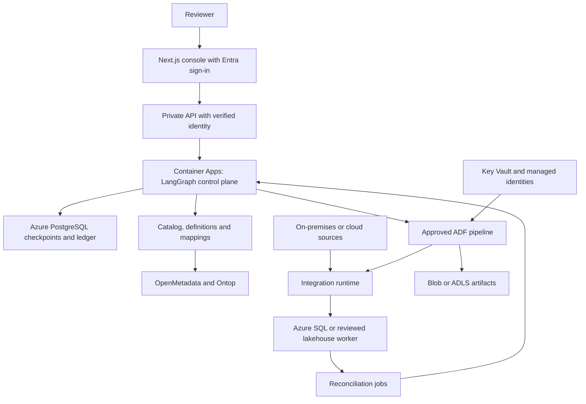

# Azure architecture and execution guide

## What is implemented

The shipped compiler generates a reviewed ADF pipeline, datasets and an ARM
deployment template for **SQL Server/Azure SQL → Azure SQL** snapshot upserts.
Mappings are explicit identity/rename mappings and target keys are mandatory.
Arbitrary expressions, other connector combinations and CDC are rejected by this
compiler until a reviewed template is added. The broader Azure architecture can
use ADF's other supported connectors; their availability is not evidence this
repository implements every combination.

The real Python adapter submits an existing ADF pipeline, verifies the deployed
pipeline/dataset definitions, monitors runs, and reconciles uncertain submissions.
Tests use fake SDK clients. An Azure deployment and live database migration have
not been performed as part of this release.

## Shipped pilot deployment

The API GitHub workflow publishes a smoke-tested image to ACR after tests and a green
SonarQube gate. A protected environment then approves the exact image digest;
a separate federated identity invokes Azure Run Command on one existing VM.
The VM pulls with its own managed identity and stores the workspace on a locally
mounted encrypted managed disk. Azure Files is not supported for this SQLite
workspace.

The Next.js console is a companion Node.js container in the runtime layout.
The existing Run Command rollout manages the API image; frontend publication
and rollout must be added through a separately reviewed release process.

```mermaid
flowchart TD
    GitHub["GitHub tests and SonarQube gate"] --> ACR["ACR immutable image"]
    GitHub --> Approval["Protected environment approval"]
    Approval --> Command["Federated deployment identity and Run Command"]
    ACR --> VM["One Azure VM API and LangGraph container"]
    Command --> VM
    User["Authorized operator"] --> Proxy["Private TLS ingress and host proxy"]
    Proxy --> Console["Next.js console and session routes"]
    Console --> VM
    VM --> Disk["Local managed disk: SQLite, receipts and locks"]
    VM --> ADF["Approved Data Factory pipeline"]
```



The API is published only on the host's loopback interface. Provision the TLS
proxy, private ingress and organizational identity boundary separately. The
deployment script drains control-plane work and preserves the local workspace;
it does not cut over database traffic. See [CI/CD](../cicd.md) and the
[host runbook](../../infra/deploy/README.md).

### Adding the Next.js console

Build `frontend/Dockerfile` and publish a reviewed image digest to an approved
ACR repository. The shared quality workflow builds and checks this image; the
existing `deploy-azure.yml` publishes and deploys the API image only. The local
`compose.console.yml` starts both application services for a single-host pilot
and does not provision Azure resources.

For the VM pilot, route a trusted HTTPS reverse proxy to the console on loopback
port 3000, and let the console reach FastAPI through private host/container
networking. Set `MIGRATION_API_URL` to that fixed private API address,
`MIGRATION_UI_ORIGIN` to the exact public HTTPS origin, and provide a random
32-byte session secret as 64 hexadecimal characters in
`MIGRATION_UI_SESSION_SECRET`. Deliver those values through protected runtime
configuration. The frontend does not need the migration disk, database
credentials, ADF submission rights or the API's broader managed-identity scope.

The console uses encrypted HTTP-only cookies and checks its request origin;
the Python API still enforces each role and connection/table scope. Entra ID
SSO, tenant lifecycle and federated user-to-role mapping are planned work. An
HTTPS proxy or a token sign-in form does not automatically supply that integration.

Promote a compatible frontend/API pair with recorded image digests and browser
smoke evidence. Continue to drain the API before replacing its container. A
frontend restart does not stop a migration or authorize rollback of committed
rows. The console's own health route validates its process/configuration, not
database reachability. See [frontend setup](../frontend.md) for the connection
registry, runtime settings and local test commands.

## Future production topology



This is a reference design requiring further implementation. The shipped local
control plane uses SQLite and file locks. Implement shared PostgreSQL checkpoints,
submission receipts, workspace records, distributed fencing/maintenance and Blob
artifact storage before moving it to Container Apps or multiple replicas. A
PostgreSQL checkpointer alone does not replace all local state; the deployment
workflow intentionally targets the single VM pilot above.

## Configure and deploy the sample

1. Install `pip install -e '.[azure]'`. Use Azure workload identity/managed
   identity in deployed services or a configured Azure CLI login for development.
2. Provision an existing Data Factory, reviewed source/target linked services,
   network connectivity, and the target tables with correct column types and
   unique keys. On-premises connectivity generally requires a suitable
   self-hosted integration runtime; evaluate the connector's current requirements.
3. Update `examples/cloud/azure-copy.json`. The compiler does not resolve database
   connection strings; ADF linked services own those credentials.
4. Compile the artifacts:

   ```bash
   python examples/cloud/compile_and_inspect.py azure examples/cloud/azure-copy.json output/azure
   ```

5. Review `output/azure/arm_template.json`. It creates/updates only the specified
   datasets and pipeline in an existing factory. Deploy through your approved
   infrastructure process. For an explicitly authorized deployment:

   ```bash
   az deployment group create --resource-group migration-rg --template-file output/azure/arm_template.json
   ```

6. Start the cloud LangGraph review flow; approve its full bundle hash and poll
   with the same thread and operation ID. Native success ends in
   `EXECUTION_SUCCEEDED_REQUIRES_RECONCILIATION`.

Dataset names include the plan fingerprint to avoid collisions between different
mappings. Activities run in dependency order, use upsert, reject incompatible rows,
and disable data truncation. The compiler does not create target tables, disable
constraints, propagate deletes, or synthesize identity-column handling. Review
target identities/computed columns and preflight with representative data.
Nonempty `quality_rules` are rejected; this Copy template does not implement the
local engine's validation/correction operations. Add a separately reviewed worker
to enforce them before enabling such plans.
Explicit decimal precision/scale or timezone contracts also require a typed
worker and are rejected here. The compiler does not inspect live physical column
types; compatibility of the existing source/target schema is a preflight duty.

## Submission and recovery

ADF `create_run` does not offer a general idempotency token. The adapter reserves
an operation in a durable SQLite claim ledger **before** the call. It sends a
correlation token and bundle hash as pipeline parameters. If the acknowledgement
is lost, another attempt with the same operation key queries native run history
and reuses the unique matching run.

If no matching run is visible, the outcome stays unknown. The adapter does not
blindly create another run. Review ADF run history and activity logs; delayed
visibility or run-history retention may prevent automatic reconciliation. Never
delete the ledger or choose a fresh key merely to bypass an unknown result.
Distributed production deployments need a shared durable claim ledger with
equivalent unique-key claims and fencing.

The caller must freeze the source or use an independently established consistent
snapshot. Retrying keyed upserts does not establish snapshot isolation, remove
deleted source rows or preserve transactional consistency across multiple tables.
ADF file-copy resume semantics are also not a universal row-level checkpoint.

## Extending to CDC and lakehouse workloads

- Check native CDC availability for the exact ADF connector and endpoint version.
  A timestamp watermark is a different extraction strategy and may miss deletes
  or late transactions unless explicitly designed to capture them.
- Introduce separate reviewed Data Flow or Databricks job templates for complex
  transformations. Reuse the same mapping contract, approval and validation gates.
- Use ADLS/Delta staging where the workload requires it. Treat schema evolution,
  SCD2 history, surrogate-key generation and transactional cutover as explicit
  implementations, not automatic consequences of selecting `star_schema`.
- OpenMetadata catalogs entities, lineage and governance information; Ontop
  provides a semantic query layer over supported SQL-accessible data. Neither
  replaces the database/Unity Catalog authorization boundary.

## Official references

- [ADF Copy Activity](https://learn.microsoft.com/en-us/azure/data-factory/copy-activity-overview)
- [Azure SQL upsert and mapping configuration](https://learn.microsoft.com/en-us/azure/data-factory/connector-azure-sql-database)
- [SQL Server connector](https://learn.microsoft.com/en-us/azure/data-factory/connector-sql-server)
- [ADF CDC mechanisms and connector limits](https://learn.microsoft.com/en-us/azure/data-factory/concepts-change-data-capture)
- [Python create_run API](https://learn.microsoft.com/en-us/python/api/azure-mgmt-datafactory/azure.mgmt.datafactory.operations.pipelinesoperations)
- [Python pipeline run query API](https://learn.microsoft.com/en-us/python/api/azure-mgmt-datafactory/azure.mgmt.datafactory.operations.pipelinerunsoperations)
