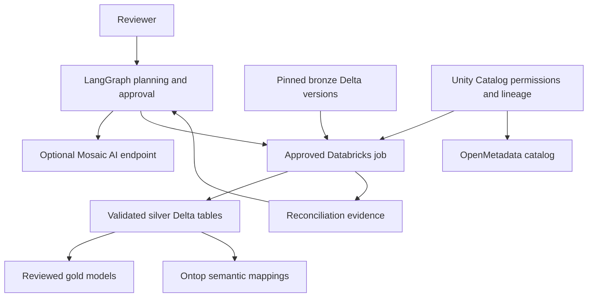

# Databricks, Delta Lake, Unity Catalog and Mosaic AI

## Distinct responsibilities

| Component | Role in this repository/design |
|---|---|
| LangGraph | Planning, explicit approval, native job submission, status and exception routing |
| Databricks Jobs | Executes an existing reviewed job using stable idempotency tokens |
| Databricks SQL connector | Reads/writes supported catalog tables through a SQL warehouse; see the connector matrix |
| Delta Lake connector | Local/open Delta access through delta-rs and Arrow, subject to supported protocol/features |
| Databricks Spark + Delta | Scalable execution path for reviewed lakehouse transformations |
| Unity Catalog | Access control, data assets, workspace/native lineage and credentials |
| Mosaic AI Model Serving | Optional model endpoint for agent recommendations; source records do not pass through it for migration |
| OpenMetadata | Cross-platform catalog, ownership, classifications and migration lineage publication |
| Ontop | Semantic mappings and SPARQL over supported SQL-accessible data |

"Mosaic AI" refers to Databricks' AI platform/model serving. The separate
geospatial Mosaic library would require its own domain-specific transformations;
no GIS migration support is implied here.



Gold aggregates, SCD2 dimensions and automatic star-schema design are architectural
extension points. Selecting `workload: star_schema` classifies the plan and helps
organize dependencies; it does not generate surrogate keys or business grain.
Define and approve the grain, dimensions, facts, join rules and history strategy.

## Shipped execution paths

1. The local connector-based worker handles bounded snapshots. Delta file paths
   are handled by the delta-rs connector; Databricks catalog access uses the
   Databricks SQL connector. These are different APIs with different limitations.
2. `datamigration.cloud.databricks` compiles a contract for an existing job and
   submits it with the Databricks SDK. The job must accept the three migration
   parameters and perform the operations in its approved manifest.
3. `infra/databricks/delta_table_job.py` is a concrete **Delta-to-Delta Spark job
   example within one workspace**. It requires explicit source versions and
   primitive identity/rename mappings. It validates keys and types, performs
   keyed MERGE, and reconciles complete projected rows using `exceptAll` in both
   directions. It rejects unsupported transforms and schema changes.

The native job compiler and reference Spark worker reject nonempty
`quality_rules`; the local engine's validation/correction behavior is not silently
discarded. The reference worker verifies declared decimal precision/scale against
the source's physical type and accepts only UTC when a timestamp timezone is
specified. More complex cleaning or timezone conversion needs a reviewed worker
that implements those semantics before target writes.

The Spark example is source-reviewed/compiled here; a Databricks Runtime was not
available to execute it. Qualify it in your workspace/runtime and permissions
before use. This is not a tested generic JDBC-to-Delta or NoSQL-to-Delta job.

## Configure the native Delta example

1. Install `pip install -e '.[databricks]'`. Provision a workspace, an approved
   job compute policy, required UC catalog/schemas, a control volume, and source
   Delta tables. Workload identity/OAuth is preferred for production SDK access.
2. Upload `infra/databricks/delta_table_job.py` to the reviewed workspace location.
   Review `infra/databricks/job.example.json`, replace the cluster/file references,
   and deploy it through normal Databricks job/IaC controls. Default task retries
   are disabled; automatic retries should be enabled only after recovery testing.
3. Edit `examples/cloud/databricks-delta.json`: replace `job_id`, UC names, the
   volume path and `source_versions`. Obtain the intended source versions from
   `DESCRIBE HISTORY`; ensure data/log retention preserves them for the migration.
4. Create target tables with the correct schemas, or explicitly approve
   `policy.allow_create_tables: true`. The example never automatically drops,
   truncates, evolves schemas or deletes unmatched target rows.
5. Upload the exact reviewed JSON spec to the stated volume path and restrict its
   writers. Compile locally:

   ```bash
   python examples/cloud/compile_and_inspect.py databricks examples/cloud/databricks-delta.json output/databricks
   ```

6. Bind the workspace host in the cloud workflow's executor config and approve
   the full bundle hash. Job parameters carry the manifest URI, canonical spec
   hash and a stable hashed operation ID. The job verifies the spec hash before
   reading sources or writing targets.

The job settings and its deployed script must remain immutable under deployment
change control for the approved run. A job ID alone does not pin a code revision.
This adapter does not independently hash every workspace library or job setting;
the operator must pin the script/library revision and compute policy.

Native task success ends the control workflow with
`EXECUTION_SUCCEEDED_REQUIRES_RECONCILIATION`. Review the job's validation reports
and any additional business reconciliation before publication/cutover. The example
prints structured per-table reports to job logs; configure durable report export
and retention for your environment.

## Snapshot semantics and failure handling

- Source versions are explicitly pinned. A set of per-table versions is not
  automatically a transactionally consistent cross-table business snapshot; select
  a coherent set or quiesce upstream writes when that requirement applies.
- Keep a single migration writer per target scope. Delta's transactions protect
  table commits; they do not replace application-level migration ownership or
  make a multi-table migration one atomic transaction.
- Keys must be non-null and unique. The job does not silently deduplicate inputs.
- Both compared datasets use the same typed, ordered projection. With
  `target_scope: entire_table`, extra target rows fail reconciliation. With
  `mapped_keys`, unrelated target keys are intentionally excluded.
- Target writes completed before a later failure remain for inspection. Repeat
  the same approved source versions and operation ID; keyed MERGE is repeatable.
  Coordinate retry ownership between Jobs, the adapter and the workflow.
- CDC/Delta Change Data Feed, streaming checkpoints, schema evolution and SCD2
  require their own reviewed jobs and tests. They are not implemented by the
  snapshot example. Time travel alone is not a safe rollback after new target
  writes have been accepted.

## Governance and AI

Grant the job principal only the required `USE CATALOG`, `USE SCHEMA`, `SELECT`,
target write privileges and volume access. Grant table creation only if the plan
requires it. Keep access policies and credentials in Unity Catalog/cloud identity.
Publish metadata/lineage to OpenMetadata using its API; metadata publication does
not itself enforce warehouse permissions.

Use the optional Databricks advisor configuration for a compatible Mosaic AI
serving endpoint. The model proposes mappings or explains failures from approved
metadata. It cannot grant permissions, mark reconciliation as passed, or deploy
its suggestions without the normal approval path. Ontop mappings target an
SQL-accessible view/catalog interface; Ontop is not a Delta file ingestion engine.

## Official references

- [Jobs run-now and idempotency tokens](https://docs.databricks.com/api/jobs/v2/run-now)
- [Delta time travel](https://docs.databricks.com/aws/en/sql/language-manual/sql-ref-syntax-qry-select-table-reference)
- [Delta MERGE and duplicate-match semantics](https://docs.databricks.com/aws/en/delta/merge)
- [Unity Catalog privileges](https://docs.databricks.com/aws/en/data-governance/unity-catalog/access-control/privileges-reference)
- [Foundation Model Serving endpoints](https://docs.databricks.com/aws/en/machine-learning/model-serving/create-foundation-model-endpoints)
- [Ontop supported SQL backends](https://ontop-vkg.org/guide/)
