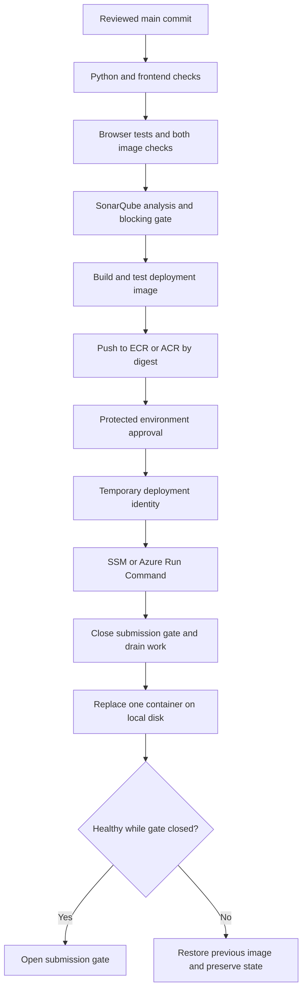

# CI/CD, SonarQube and cloud deployment

The repository includes working GitHub Actions definitions for verification and
for deploying an API image to an **existing single AWS EC2 host or Azure VM**.
The shared verification also checks the Next.js console and its container.
The existing cloud deployment jobs still publish and deploy the API image only;
frontend companion rollout is described in [frontend setup](frontend.md).
The deployment jobs do not create cloud resources or run data migrations. No
SonarQube scan or live cloud deployment was executed during local verification.
The first GitHub CI run reached the required configuration check and stopped
because `SONAR_HOST_URL` did not identify a valid HTTPS server. Configure the
services below and qualify the pipeline in a pilot; no quality gate was bypassed.

## Pipeline and approval boundaries



The image digest appears in the image job summary before the deployment
environment asks its reviewers to approve. Image publishing and host deployment
use separate identities. All third-party actions are pinned to full commit SHAs;
review and update these pins as dependencies change.

| Workflow | Trigger | Result |
|---|---|---|
| `ci.yml` | Pull requests to `main`, pushes to `main`, manual run | Calls the shared verification workflow. |
| `quality.yml` | Reusable workflow only | Python/frontend lint, type checking, unit coverage, package/Next.js builds, real synthetic browser tests, both container checks, and the required main/deployment Sonar gate. |
| `deploy-aws.yml` | Manual, `main` only | Mandatory quality gate; tested image to existing ECR; environment approval; SSM rollout to one host. |
| `deploy-azure.yml` | Manual, `main` only | Mandatory quality gate; tested image to existing ACR; environment approval; Run Command rollout to one VM. |

Fork and Dependabot pull requests run verification without analysis secrets.
Same-repository PR analysis is enabled by `SONAR_PR_ANALYSIS=true`. Leave that
variable unset if your SonarQube edition does not support PR analysis. Analysis
is always required on `main` and in both deployment workflows. A missing server,
token, failed analysis, red gate or gate timeout blocks deployment; there is no
`continue-on-error` bypass. A successful pull-request test job without Sonar
analysis is not a SonarQube approval.

## Configure SonarQube

1. Provision your organization's SonarQube Server and create the project key
   `mahi80_DataMigration`, or update `sonar-project.properties` to your key.
2. Assign a quality gate and define its new-code baseline. Review the gate's
   security, reliability, maintainability, coverage and duplication conditions;
   the workflow enforces the server's result rather than inventing its own pass.
   A useful starting policy is no new blocker/critical findings and the team's
   agreed new-code coverage threshold. Do not lower a gate to conceal failures.
3. Generate a project analysis token with only the necessary project permission.
   Set repository secret `SONAR_TOKEN` and repository variable `SONAR_HOST_URL`
   to the approved HTTPS endpoint. Set optional secret `SONAR_ROOT_CERT` when
   the server uses a private CA supported by the scan action.
4. Make the server reachable from the runner. For a private server, use a
   dedicated ephemeral runner in the permitted network and change `runs-on`.
   Never route untrusted fork code onto a privileged persistent runner.
5. Configure branch protection/rulesets to require the verification job and
   approved reviews. Restrict changes to workflows, deployment scripts and the
   Sonar configuration through repository ownership/review policy.

Pytest writes `coverage.xml` with relative source paths and `reports/junit.xml`.
The scanner reads those files; SonarQube does not run Python tests itself. The
scanner uses `sonar.qualitygate.wait=true` and a 600-second gate timeout, making
the analysis step fail when the gate fails. See the official
[GitHub integration](https://docs.sonarsource.com/sonarqube-server/2025.4/devops-platform-integration/github-integration/adding-analysis-to-github-actions-workflow)
and [Python coverage guidance](https://docs.sonarsource.com/sonarqube-server/analyzing-source-code/test-coverage/python-test-coverage).

Frontend Vitest coverage is written to `frontend/coverage/lcov.info`. CI
normalizes its source paths to the repository root, then the scanner imports it
through `sonar.javascript.lcov.reportPaths`. The same property covers JavaScript
and TypeScript. Browser tests provide workflow evidence but do not automatically
contribute LCOV coverage. Frontend application code is included in the analysis
even where unit coverage remains incomplete. See the official
[JavaScript/TypeScript coverage guide](https://docs.sonarsource.com/sonarqube-server/analyzing-source-code/test-coverage/javascript-typescript-test-coverage).

CI and the container build use the checked-in dependency lock. Run the same
verification commands in that locked environment locally:

```bash
python -m pip install 'uv==0.13.6'
uv sync --frozen --extra dev --extra aws --extra azure --extra databricks
.venv/bin/ruff check .
.venv/bin/pytest --cov=datamigration --cov-config=infra/coverage.ini --cov-report=xml:coverage.xml --junitxml=reports/junit.xml
bash -n infra/deploy/deploy_host.sh
.venv/bin/python -m build
docker build -t datamigration:review .
.venv/bin/python infra/deploy/smoke_image.py datamigration:review
cd frontend
npm ci
npm run lint
npm run typecheck
npm run test:coverage
npm run build
npx playwright install --with-deps chromium
npm run test:e2e
docker build -t datamigration-console:review .
```

The smoke test uses disposable local state and a generated token. It checks API
health, rejection of unauthenticated calls, and that the API and CLI share the
maintenance barrier. Unit tests and smoke tests do not prove live database
compatibility, IAM permission correctness, CDC behavior or cloud networking.

The frontend image check supplies a generated session secret and checks
`/api/health` for process/configuration health. It does not pretend a customer
database or private API is reachable. The Playwright suite starts a real local
FastAPI fixture and Next.js server for browser integration tests, using only
synthetic data. The quality workflow retains frontend coverage and browser
diagnostics alongside the Python reports.

## GitHub variables and secrets

Create `aws-pilot` and `azure-pilot` environments. Configure **required reviewers**,
disable self-approval where appropriate, and restrict deployable branches to
`main`. An `environment:` name in YAML does not create these protection rules.
Reviewers should inspect the digest and verification evidence before approving.

| Scope | Name | Meaning |
|---|---|---|
| Repository secret | `SONAR_TOKEN` | Project analysis token. |
| Repository secret, optional | `SONAR_ROOT_CERT` | Trusted private CA certificate. |
| Repository variable | `SONAR_HOST_URL` | HTTPS SonarQube Server endpoint. |
| Repository variable, optional | `SONAR_PR_ANALYSIS` | `true` only when same-repository PR analysis is supported and desired. |
| Repository variable | `AWS_REGION` | Region shared by the ECR image and EC2 deployment. |
| Repository variable | `AWS_ECR_REPOSITORY` | Full existing repository URI, for example `123456789012.dkr.ecr.eu-west-1.amazonaws.com/datamigration`. |
| Repository variable | `AWS_BUILD_ROLE_ARN` | OIDC role allowed to publish only to that ECR repository. |
| `aws-pilot` variable | `AWS_DEPLOY_ROLE_ARN` | OIDC role allowed to issue the approved host-management command. |
| `aws-pilot` variable | `AWS_INSTANCE_ID` | One preprovisioned SSM-managed EC2 instance. |
| Repository variable | `AZURE_TENANT_ID`, `AZURE_SUBSCRIPTION_ID` | Tenant/subscription identifiers. |
| Repository variable | `AZURE_BUILD_CLIENT_ID` | Federated identity for publishing to ACR. |
| Repository variable | `AZURE_ACR_NAME` | Existing lowercase registry name, without `.azurecr.io`. |
| Repository variable | `AZURE_IMAGE_REPOSITORY` | Repository path within the registry, such as `datamigration`. |
| `azure-pilot` variable | `AZURE_DEPLOY_CLIENT_ID` | Separate federated identity for the reviewed VM Run Command operation. |
| `azure-pilot` variable | `AZURE_RESOURCE_GROUP`, `AZURE_VM_NAME` | Existing target VM. |

No AWS access keys, Azure client secrets, source database passwords or application
API tokens belong in the workflow. Application credentials are installed on the
managed host by the secret-management process described in
[`infra/deploy/README.md`](../infra/deploy/README.md).

## Workload federation and least privilege

For AWS, configure GitHub's OIDC issuer and the expected `sts.amazonaws.com`
audience. The image role must match this repository's `main` subject; the deploy
role must match the `aws-pilot` environment subject. Permit ECR push actions only
on the chosen repository, with the required authorization-token action. Scope
`ssm:SendCommand` to the one instance and `AWS-RunShellScript` document; allow the
read actions needed to poll its result. These commands execute as host root, so
protect this role as a host-administration capability. Use the
[official AWS federation setup](https://docs.github.com/en/actions/how-tos/secure-your-work/security-harden-deployments/oidc-in-aws).

For Azure, create separate federated build/deploy identities with GitHub's issuer
and the `api://AzureADTokenExchange` audience. Bind the build identity to `main`
and the deploy identity to `azure-pilot`. Give the build identity registry-scoped
push rights. Give the deployment identity only VM read/Run Command permissions
required by `az vm run-command invoke` on the selected VM, plus any required
operation-result read permission at its narrowest supported scope. The Compute
permission for action Run Command is
`Microsoft.Compute/virtualMachines/runCommand/action`; managed Run Command has
separate `runCommands/*` operations. Validate this role with your current Azure
API/CLI version. See [Azure federation](https://docs.github.com/en/actions/how-tos/secure-your-work/security-harden-deployments/oidc-in-azure)
and [Compute permissions](https://learn.microsoft.com/en-us/azure/role-based-access-control/permissions/compute).

Use the repository's **actual OIDC subject format**. GitHub documents immutable
owner/repository IDs in the default subject for newly created repositories after
July 15, 2026. For example, a subject can look like
`repo:OWNER@OWNER_ID/REPO@REPO_ID:environment:aws-pilot`; older repositories can
retain `repo:OWNER/REPO:environment:aws-pilot`. Do not add broad wildcard trust
to make a mismatched subject pass. The environment trust relies on the
environment's `main` restriction because its subject does not itself include the
branch.

ACR roles depend on its permissions mode: use `AcrPush`/`AcrPull` for traditional
registry RBAC or the appropriate Repository Writer/Reader roles for ABAC-enabled
registries. Scope access to the repository when supported. The VM pulls with its
own managed identity; it does not receive the GitHub build identity. See
[ACR managed identity authentication](https://learn.microsoft.com/en-us/azure/container-registry/container-registry-authentication-managed-identity).

## Deployment, recovery and production transition

Complete the [host prerequisites](../infra/deploy/README.md), then manually run
the relevant workflow from `main`. A green pipeline verifies an application
deployment; migration plan approval, reconciliation and traffic cutover remain
separate operations. Native Glue/DMS/ADF/Databricks jobs retain their own lifecycle.

The host script pulls a digest-pinned image before entering maintenance, blocks
new work, waits up to ten minutes for active control-plane work, and replaces the
container only after it drains. It checks the new API while the gate remains
closed. Failures before unpause restore the prior image when possible, preserving
the same state volume. Once unpause is attempted, an uncertain response requires
operator inspection because new work may have started; automatic replacement is
no longer safe. A timeout or cancelled CI job does not prove the remote command
stopped. Inspect SSM/Run Command and host state before another attempt.

The shipped pilot uses SQLite and host file locks. **Do not mount its state on
EFS, Azure Files, NFS or SMB, and do not run it across multiple hosts.** ECS Fargate
and Azure Container Apps appear as future reference architectures in the cloud
guides. Before moving to either, implement shared PostgreSQL checkpoint and
submission stores, distributed leases/fencing, distributed maintenance/drain,
artifact storage, and checkpoint/schema compatibility testing. Changing only
the deployment YAML would not make the existing local state safe to scale.
