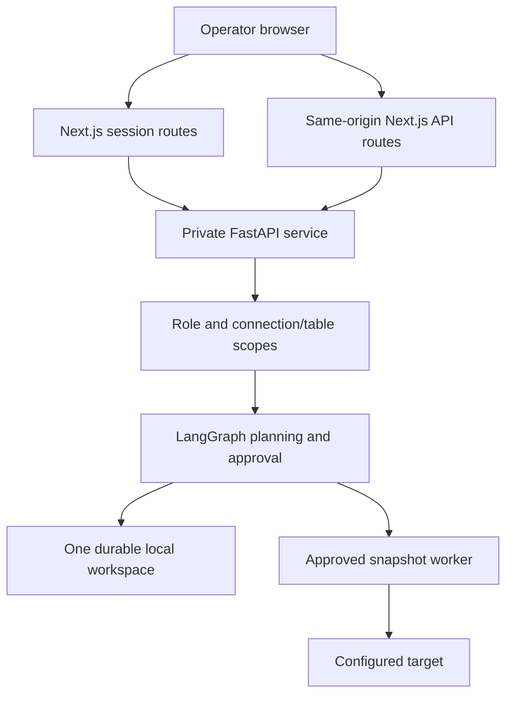

# Next.js migration console

The console in `frontend/` turns the snapshot workflow into an operator-facing
application: select registered connections, inspect tables, review mappings,
create a plan, approve its exact hash, and inspect reconciliation results.
It uses the same FastAPI, role checks and LangGraph execution path as the CLI.
Metrics and run history come from the API; the application does not seed a live
workspace with invented production runs or success rates.

## Screens and supported operations

| Screen | Purpose |
| --- | --- |
| Sign in | Validate a configured workspace access token and establish a browser session |
| Overview | Show current service health, loaded-run summaries and pending reviews |
| Migrations | Browse scoped run history, filter statuses and open a run |
| Connections | Inspect the registered source/target choices visible to the authenticated identity |
| New migration | Discover source tables, edit explicit mappings and keys, assert a stable source, and create a plan |
| Run detail | Inspect the exact plan, mapping lineage, quality rules, approval state and validation results |

The console controls **local snapshot migrations**. Native Glue, DMS, ADF and
Databricks job orchestration remains available through the existing cloud CLI
and Python interfaces. A connector appearing in the console is not a claim
that a particular remote database pair has passed live-service qualification.

## Request and authorization architecture



The browser talks to its own Next.js origin. Server-side routes forward only
the supported operations to the fixed `MIGRATION_API_URL`. They do not accept
an arbitrary backend URL from a request. The access token is validated against
the Python API and held in an encrypted, HTTP-only session cookie. Mutations
check the configured origin; application secrets are not exposed through
`NEXT_PUBLIC_*`, JavaScript-readable storage or browser-visible connection URLs.

Frontend role-aware controls improve usability; the Python API independently
checks the action and every connection/table scope. An approval records the
authenticated API identity. A user cannot gain permission by changing browser
state, editing a request role, or revealing a hidden button.

This pilot uses configured access tokens. It does not implement enterprise
OIDC/SSO, organization provisioning or multi-tenant isolation. A workspace token
is an application credential, not a database password. Follow
[protocols and RBAC](protocols-and-rbac.md) for token lifecycles and native
database permissions.

## 1. Configure the Python API

Install the locked Python dependencies from the repository root. Select the
additional drivers required by your actual source and target:

```bash
python -m pip install 'uv==0.13.6'
uv sync --frozen --extra dev --extra postgres --extra aws --extra azure --extra databricks
```

The API reads its connection inventory from the server-owned
`MIGRATION_CONNECTIONS` JSON array. Each entry has an identifier, display label,
connector kind, environment-variable reference and approved connector options:

```json
[
  {
    "id": "commerce-source",
    "label": "Commerce source",
    "kind": "postgresql",
    "url_env": "COMMERCE_SOURCE_URL",
    "options": {"schema": "public"},
    "description": "Read-only migration source"
  },
  {
    "id": "analytics-target",
    "label": "Analytics target",
    "kind": "delta",
    "url_env": "ANALYTICS_DELTA_ROOT",
    "options": {},
    "description": "Dedicated snapshot destination"
  }
]
```

Supply the actual `COMMERCE_SOURCE_URL`, `ANALYTICS_DELTA_ROOT` and access tokens
through the API process environment or secret-management system. The registry
contains references rather than passwords or resolved connection strings. The
console cannot create database credentials or edit this server-owned registry.
An empty connection list means the server has no configured choices in the
caller's scope; it is not permission to enumerate environment variables.

For a shared pilot, configure separate planner and approver token identities.
For any scoped identity, its `connection_options` must match the registry entry,
and its table allowlist must use the connector's exact names. For example,
PostgreSQL tables use names such as `public.customers`.

Start the API in one terminal:

```bash
uv run --no-sync datamigrate serve --host 127.0.0.1 --port 8000 --workspace .migration
```

The API requires `MIGRATION_API_TOKEN` or `MIGRATION_API_TOKEN_ROLES` to be
configured. The legacy single token grants administrator access; it is suitable
only for a trusted local operator. Use distinct role bindings for shared work.

## 2. Start the Next.js console

Use Node.js 22 and the checked-in npm lockfile. In another terminal:

```bash
cd frontend
npm ci
cp .env.example .env.local
```

Configure these **server-only** values in `frontend/.env.local`:

```dotenv
MIGRATION_API_URL=http://127.0.0.1:8000
MIGRATION_UI_ORIGIN=http://localhost:3000
MIGRATION_UI_SESSION_SECRET=<64-random-hex-characters>
```

Generate a new 32-byte session secret, represented as 64 hexadecimal characters:

```bash
python -c "import secrets; print(secrets.token_hex(32))"
```

Then run:

```bash
npm run dev
```

Open `http://localhost:3000` and sign in with the configured workspace token.
The browser origin must match `MIGRATION_UI_ORIGIN`; `localhost` and `127.0.0.1`
are different origins. Remote origins must use HTTPS. The API URL can be a
private HTTP service address inside the trusted deployment network or an HTTPS
address. Keep it fixed in server configuration.

Rotating the session encryption secret invalidates existing browser sessions.
Changing/revoking a backend token is enforced when the API authenticates a
subsequent request. The browser does not obtain permanent authority from the
role that was visible when it first signed in.

## 3. Use the workflow

1. Select the source and destination from the connection registry. Confirm the
   intended database/namespace and inspect the discovered table schemas.
2. Select source tables and review target names, column types, transformations,
   nullability and migration keys. Keep the mapping within the connector's
   supported contract.
3. Confirm that the source is actually stable: a maintenance window, immutable
   export or suitable snapshot must already exist. The checkbox does not pause
   a database or establish CDC consistency.
4. Create the plan. This performs discovery/planning and stops for approval;
   creating a plan does not authorize destination writes.
5. An approver reviews the exact plan and its hash, including corrections and
   target scope, then approves or rejects it. Approval can start destination
   writes immediately through the existing worker.
6. Inspect the run status and per-table validation. Only a successfully
   reconciled snapshot finishes as `COMPLETED`.

If a request times out or its response is lost, inspect the existing run ID
before retrying. Do not create a second migration merely because the browser
did not receive the first response. A failed run can contain committed target
batches; retained receipts and staging support controlled recovery. Browser
refresh or sign-out does not cancel a running database operation.

Overview counts refer to the runs loaded by the console, rather than an
unbounded organization-wide analytics store. Per-table reports show actual
mapped-row reconciliation and correction counts. No throughput or cost estimate
is inferred from a small synthetic example.

## Build, browser tests and SonarQube

From `frontend/`:

```bash
npm ci
npm run lint
npm run typecheck
npm run test:coverage
npm run build
npx playwright install --with-deps chromium
npm run test:e2e
```

Browser tests start their own synthetic FastAPI fixture using the repository's
`.venv/bin/python`, plus a local Next.js server. Install the locked Python test
environment first. These tests do not connect to a customer database or use
production cloud credentials.

The shared quality workflow runs frontend checks before its blocking SonarQube
analysis. Python coverage comes from `coverage.xml`; frontend unit coverage is
written to `frontend/coverage/lcov.info`, with source paths normalized relative
to the repository. Browser screenshots/traces are diagnostic evidence and are
not counted as unit coverage. All frontend source remains within the analysis
scope, including UI code that may need additional test coverage.

Configure the real SonarQube server and project token as described in
[CI/CD](cicd.md). Linting or browser success is not evidence that a SonarQube
quality gate passed. The server's configured gate remains authoritative.

## Containers and cloud placement

The frontend Dockerfile uses Next.js standalone output. This application needs
a running Node.js server for its session/proxy routes; a static HTML export
does not provide the implemented authentication boundary. Set runtime secrets
on the running container, never in the image build context or public variables.

Use the root `compose.console.yml` for a local, single-host pilot. It reads
separate `.env.console-api` and `.env.console-ui` files, routes the console to
`http://api:8000` internally, and exposes ports only on loopback. Its local
named volume belongs to the API; it is not shared state for multiple hosts.
For a cloud
pilot, put a trusted TLS reverse proxy in front of the Next.js container, keep
FastAPI on the private host/container network, and retain the API workspace on
one local encrypted disk. The frontend has no need to mount the migration
workspace or receive source database credentials.

The existing `deploy-aws.yml`, `deploy-azure.yml` and host rollout script deploy
the **API image only**. CI also builds the frontend image, but that is not an
automatic frontend registry publication or cloud rollout. Publish and deploy
the companion frontend image through a reviewed extension to that process,
retaining its digest and API compatibility evidence. See the updated
[AWS](architecture/aws.md) and [Azure](architecture/azure.md) layouts.

## Official references

- [Next.js self-hosting and reverse-proxy guidance](https://nextjs.org/docs/app/guides/self-hosting)
- [Next.js environment-variable behavior](https://nextjs.org/docs/app/guides/environment-variables)
- [Next.js standalone container example](https://github.com/vercel/next.js/tree/canary/examples/with-docker)
- [SonarQube JavaScript/TypeScript coverage](https://docs.sonarsource.com/sonarqube-server/analyzing-source-code/test-coverage/javascript-typescript-test-coverage)
