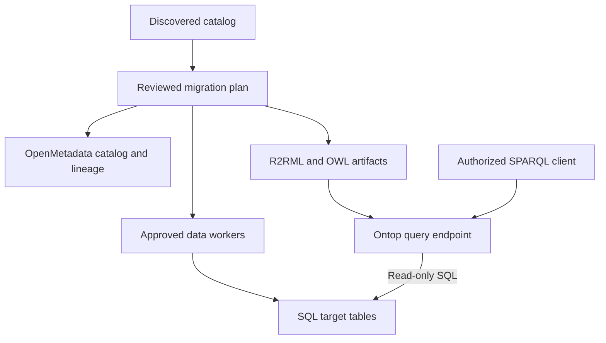

# Ontology and governance

The migration workbench separates metadata publication, semantic querying, and
data-access enforcement. Adding a catalog or an ontology does not itself make a
migration correct or grant access to source data.

## Responsibilities

| Component | Role in this project | What remains outside this integration |
| --- | --- | --- |
| LangGraph and the migration plan | Capture mappings, evidence, approval decisions, execution references, and reconciliation results | Business-owner decisions about uncertain meanings |
| OpenMetadata | Publish table metadata and explicit source-to-target column lineage through its REST API | Source/target database authorization; an entire OpenMetadata deployment; automatic classification or policy administration |
| Ontop | Expose already-migrated SQL tables through R2RML mappings and a lightweight OWL ontology | Bulk data transfer, schema conversion, inferred business truth, and database access enforcement |
| Unity Catalog | Govern Databricks assets and access within the configured Databricks environment | Automatically governing a separate direct object-storage connection |
| Database permissions and cloud IAM | Enforce access to databases, buckets, containers, secrets, and compute | Business-level semantic approval |

OpenMetadata's API organizes tables under a service/database/schema hierarchy and
supports explicit lineage edges. Ontop uses mappings to answer semantic queries
over database data. These are complementary capabilities. See the official
[OpenMetadata API](https://docs.open-metadata.org/v2.0.x/api-reference/main-concepts/metadata-standard/apis),
[lineage API](https://docs.open-metadata.org/v2.0.x/api-reference/lineage/add), and
[Ontop introduction](https://ontop-vkg.org/guide/).



## What is implemented and tested

- `build_table_payload()` converts normalized discovery metadata into an
  OpenMetadata table upsert request. Unsupported types fail explicitly.
- `OpenMetadataClient` reads table/schema entities, publishes reviewed table
  metadata into an existing hierarchy, and adds table/column lineage.
- `build_lineage_payload()` uses resolved OpenMetadata UUIDs and fully qualified
  names. It checks that mapped columns exist when column metadata is supplied.
- `export_ontop()` produces `mapping.ttl`, `ontology.ttl`, a credential-free
  properties template, and a manifest with content hashes.
- `write_jdbc_properties_from_env()` creates a private runtime properties file
  from environment variables. Existing files are never overwritten.
- Automated tests parse generated RDF, exercise quoting and composite keys, and
  check the OpenMetadata HTTP contract using `httpx.MockTransport`.

No live OpenMetadata server or Ontop/JDBC endpoint was used to validate this
integration. The generated SQL and mappings must be validated against the
deployed versions and the actual target schema before exposing an endpoint.

## 1. Review the semantic contract

The approved migration specification is the common input. Each target table
needs explicit target columns, types, nullability, and stable keys. The ontology
export reads the **target** columns after migration transformations have already
run. It does not reapply transformations to source data.

For an entity such as a customer, review at least:

1. Whether the identifier is globally unique or scoped by source company.
2. Whether leading zeros have meaning.
3. Whether an amount is a balance, invoice value, or period total, including
   currency, scale, and treatment of reversals.
4. Whether a relationship is a declared constraint or an inferred candidate.
5. Which owner approved the meaning and which source evidence supports it.

Generated OWL classes are named from the configured target tables. They do not
assert that a table is a business ontology with universally agreed semantics.
Business owners should approve class and property meanings before reuse.
The exporter does not infer object properties from `depends_on`: execution
dependency and business relationship are different concepts.

## 2. Export an Ontop preview

Use the example mapping fragment after installing the project:

```bash
python - <<'PY'
import json
from pathlib import Path
from datamigration.governance import export_ontop

spec = json.loads(Path("examples/governance/target_mapping.json").read_text())
paths = export_ontop(spec, "artifacts/ontop", base_iri="https://data.example.com/commerce/")
print(paths)
PY
```

The example file is a semantic-export input fragment. It defines a customer
dimension and an order fact that already have stable source identifiers. It does
not implement surrogate-key generation, joins, SCD Type 2 history, or the
creation of a new dimensional model from arbitrary OLTP tables.

The result contains:

| File | Contents |
| --- | --- |
| `mapping.ttl` | One R2RML triples map per configured target table |
| `ontology.ttl` | Table classes and typed scalar properties |
| `ontop.properties.example` | Clearly marked placeholders; no resolved URLs or secrets |
| `manifest.json` | Backend, target keys, hashes, preview/reviewed status, and validation requirements |

`approved=True` records the caller's review status in the offline manifest. It
does not publish an endpoint or replace an authenticated approval record.

### Keys and identifier handling

Subject IRIs use the configured table and key values. Composite keys use separate
path segments so, for example, `(1, 23)` cannot collide with `(12, 3)` merely
because of concatenation. R2RML defines IRI-safe encoding of substituted values.
The key columns must be present, non-null, and actually unique in the target;
the exporter cannot verify those database facts offline.

Physical column identifiers are quoted according to the target SQL dialect.
Safe projection aliases are used inside R2RML templates so spaces, quotes,
braces, and Unicode in business column names do not become template syntax.
Target table strings use dot-separated qualification such as
`public.dim_customer` or `commerce.gold.fact_order`. A literal dot inside one
identifier is not represented by this syntax; expose a suitably named SQL view
for that case.

The generated files implement scalar columns. Native JSON, binary, nested data,
arrays, geospatial values, and custom types require an explicitly designed SQL
projection before ontology export. The exporter rejects those types instead of
guessing an RDF representation.

### Supported Ontop-facing targets

The exporter accepts the SQL dialects for PostgreSQL, Redshift, Databricks SQL,
MySQL/MariaDB, SQL Server, Oracle, Db2, Snowflake, and DuckDB. This is **semantic
export eligibility**, not a claim that every one of those systems has a tested
migration connector in this repository. Check [the connector matrix](connectors.md)
for migration capabilities and the installed Ontop version's support matrix.

Raw Redis, MongoDB, Cassandra, and Delta-storage paths are not accepted by this
exporter. First expose approved relational projections, for example a Delta
table registered and queried through Databricks SQL. SQLite is deliberately
rejected because it is not advertised as an Ontop database backend in the
referenced support list. Ontop's database capabilities and JDBC requirements are
documented in its [guide](https://ontop-vkg.org/guide/) and
[CLI reference](https://ontop-vkg.org/guide/cli.html).

## 3. Configure and validate Ontop

Install Ontop separately and add the JDBC driver appropriate to the target
database. Create a read-only database identity with access limited to the
reviewed tables/views. Supply its settings through your process environment or
secret manager:

```text
ONTOP_JDBC_URL
ONTOP_JDBC_USER
ONTOP_JDBC_PASSWORD
```

Create a runtime file outside version control:

```bash
python - <<'PY'
from datamigration.governance import write_jdbc_properties_from_env

write_jdbc_properties_from_env(
    ".local/ontop.properties",
    driver="org.postgresql.Driver",
)
PY
```

This writes a new file with POSIX permission mode `0600` and properly escapes
Java-properties values. The `.example` template does **not** automatically
interpolate environment variables. Do not put a populated properties file in Git
or include it in published migration artifacts.

Validate the mapping with the installed Ontop CLI and selected JDBC driver. The
available `validate` flags can vary by release, so first check:

```bash
ontop help validate
```

After validation, a typical endpoint invocation is:

```bash
ontop endpoint \
  -m artifacts/ontop/mapping.ttl \
  -t artifacts/ontop/ontology.ttl \
  -p .local/ontop.properties
```

Endpoint deployment, authentication, TLS, and network access controls are your
environment's responsibility. Verify results against known SQL queries before
letting downstream agents rely on the semantic interface. Consult the
[Ontop CLI reference](https://ontop-vkg.org/guide/cli.html) for the exact flags
of your installed version.

## 4. Publish catalog metadata to OpenMetadata

Create or ingest the database service, database, and schema using OpenMetadata's
normal administration or connector process first. This client deliberately
publishes into an existing schema; it does not provision a service or receive
database credentials for OpenMetadata ingestion.

Set `OPENMETADATA_TOKEN` to a service-account bearer token with the required
catalog permissions. A server origin, `/api` base, or `/api/v1` base can be used
when constructing the client.

```python
from datamigration.governance import OpenMetadataClient

catalog = {
    "tables": [{
        "name": "dim_customer",
        "primary_key": ["customer_id"],
        "columns": [
            {"name": "customer_id", "data_type": "integer", "nullable": False},
            {"name": "customer_name", "data_type": "string", "nullable": False},
        ],
    }],
}

with OpenMetadataClient("https://metadata.example.com/api") as client:
    entities = client.publish_catalog(
        catalog,
        "warehouse.commerce.public",
        approved=True,
    )
```

Only metadata fields selected by the payload builder are sent; row samples and
database connection URLs are not part of the payload. Provide table names within
the selected schema. Group a multi-schema catalog by actual parent schema
instead of stripping qualification and accidentally merging different assets.
OpenMetadata's column-name schema excludes double quotes, `>`, and `::`.
The publisher rejects these names instead of silently renaming the asset;
use a reviewed projection when the catalog cannot represent a physical name.

You can also use the command-line example after reviewing a catalog JSON file:

```bash
python examples/governance/publish_catalog.py \
  --catalog reviewed_catalog.json \
  --schema warehouse.commerce.public \
  --server https://metadata.example.com \
  --approve
```

Table upserts use the documented `PUT /api/v1/tables` endpoint. An update can
change existing metadata; review it under the catalog owner's process. A batch
of table publications is not a transaction: record progress and reconcile after
an HTTP timeout. Missing acknowledgements do not prove the write failed.

## 5. Publish explicit column lineage

Resolve source and destination entities from the actual server first. Then build
lineage using the reviewed column mappings:

```python
from datamigration.governance import OpenMetadataClient, build_lineage_payload

with OpenMetadataClient("https://metadata.example.com") as client:
    source = client.get_table("legacy.commerce.public.customer")
    target = client.get_table("warehouse.commerce.public.dim_customer")
    payload = build_lineage_payload(
        source,
        target,
        [
            {"source": "id", "target": "customer_id"},
            {"source": "name", "target": "customer_name"},
        ],
        description="Reviewed customer mapping, migration plan version 1",
    )
    client.add_lineage(payload, approved=True)
```

This records the relationship. It does not claim that the data is fresh, the
transformation ran successfully, or all downstream business metrics are correct.
Reconciliation evidence and job status remain separate. Complex joins or several
source columns contributing to one target column require a deliberately built
multi-source lineage specification; the one-to-one helper rejects repeated
target columns rather than silently publishing incomplete lineage.

## Databricks, Delta Lake, and Mosaic AI

- **Delta Lake** is the table-storage/transaction layer. Access it through the
  supported connector or Databricks execution path and validate its protocol and
  table features against the client version.
- **Databricks SQL / Lakeflow Jobs** execute SQL and transformation workloads.
  Unity Catalog names normally identify the catalog, schema, and table.
- **Unity Catalog** governs Databricks data and AI assets. It can enforce access
  within Databricks and capture supported lineage. A direct Delta/object-storage
  path is governed by its storage credentials; do not assume Unity Catalog
  policies are automatically enforced on that separate path.
- **Model Serving**, formerly called **Mosaic AI Model Serving**, supplies an
  optional LLM endpoint to the agents. It does not move database rows or turn
  OLTP data into a valid dimensional model.
- **OpenMetadata** provides the cross-system catalog/lineage view; it can coexist
  with Unity Catalog. **Ontop** can query a suitable Databricks SQL projection
  after the target model has been reviewed.

This project uses “Mosaic AI” in the model-serving sense. The separate geospatial
Mosaic library is not installed or claimed as a transformation connector.

References: [Unity Catalog](https://docs.databricks.com/aws/en/data-governance/unity-catalog),
[Databricks product names](https://docs.databricks.com/gcp/en/resources/product-name-changes),
[R2RML standard](https://www.w3.org/TR/r2rml/),
[OpenMetadata table upserts](https://docs.open-metadata.org/v2.0.x/api-reference/data-assets/tables/create).
